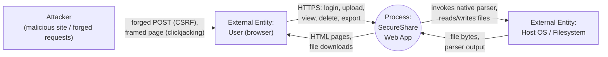
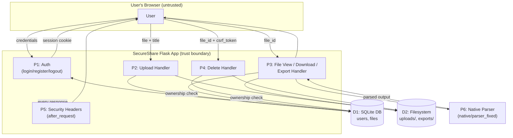

# Threat Model — SecureShare
**Course:** CYC386 — Secure Software Design and Development, Midterm Lab Exam
**Team:** Syed Zurriat Hussain (FA23-BCT-041), Muhammad Ahmadd (FA23-BCT-020), Junaid (FA23-BCT-057)
**Date:** 2026-10-30

This document covers: Context + Level-1 Data-Flow Diagrams, a systematic
STRIDE pass over every DFD element, two attack trees for the highest-impact
threats, full CVSS v3.1 scoring for every High/Critical threat, a prioritized
risk register linked to the fix commits, and a residual-risk statement.

---

## 1. Context Diagram (Level-0 DFD)



**Trust boundary 1:** Browser ↔ SecureShare (the public internet / local network).
**Trust boundary 2:** SecureShare process ↔ host OS/filesystem (process boundary,
crossed via `subprocess` and file I/O).

## 2. Level-1 DFD



**Key data stores:** D1 (SQLite: `users`, `files`), D2 (filesystem: `app/uploads/`,
`app/exports/`). **Key processes:** P1-P6 above. **External entity:** the user's
browser, which is also the vector for the attacker in CSRF/Clickjacking scenarios
(the attacker never talks to SecureShare directly — they talk to the victim's browser).

## 3. STRIDE Analysis

Applied systematically to every process, data store, and data flow in the
Level-1 DFD.

| Element | S — Spoofing | T — Tampering | R — Repudiation | I — Info Disclosure | D — DoS | E — Elevation of Privilege |
|---|---|---|---|---|---|---|
| **P1 Auth** | Credential stuffing / weak passwords (accepted risk, see §6) | Session cookie tampering → mitigated: Flask signs cookies with `SECRET_KEY` | No login audit log (residual risk, §7) | Username enumeration via differing error messages (low; out of scope) | Repeated failed logins — no rate limiting (residual risk, §7) | N/A |
| **P2 Upload** | N/A (requires valid session) | Malicious filename → mitigated: `secure_filename()` + randomized `stored_name` | No upload audit trail (residual) | Oversized/looping upload → mitigated: `MAX_CONTENT_LENGTH` | Unbounded upload size before this limit — mitigated | N/A |
| **P3 View/Download/Export** | N/A | **T1: shell command injection via `export_name`** → **FIXED** (`fix/command-injection`) | No access log for cross-user attempts beyond app logger warning | **T2: IDOR — view/download another user's file** → **FIXED** (`fix/idor`) | Oversized title crashing the parser (buffer overflow) → **FIXED** (`fix/buffer-overflow`) | Command injection (T1) is also an **E**: attacker-controlled code runs with the web server's OS privileges |
| **P4 Delete** | **T3: CSRF — forged delete as an authenticated victim** → **FIXED** (`fix/csrf`) | Same CSRF vector enables unauthorized tampering (file deletion) | No confirmation step / audit trail for deletes (residual) | N/A | Repeated forged deletes = availability loss for the victim's own data | N/A |
| **P5 Security headers / all responses** | **T4: Clickjacking — SecureShare framed in a malicious page for UI redressing** → **FIXED** (`fix/clickjacking`) | N/A | N/A | Framing could expose rendered private content to the attacker's overlay UX | N/A | Clickjacking is the delivery mechanism for forcing D/T elsewhere (e.g. tricking a click into a delete) |
| **P6 Native Parser** | N/A (invoked only by P3, not directly reachable) | **T5: stack buffer overflow via oversized `title`** → **FIXED** (`fix/buffer-overflow`) | N/A | Potential disclosure of adjacent stack memory via a crafted overflow (theoretical, not demonstrated) | Crash (SIGSEGV) on oversized input → **FIXED** | Buffer overflow is the classical primitive for E (not exploited to full RCE in this lab, but treated as Critical per CVSS, §5) |
| **D1 SQLite DB** | N/A | SQL injection — **not present**: all queries are parameterized (`?` placeholders) | No DB-level audit logging (residual) | IDOR (T2) is effectively an indirect disclosure path into D1 | DB file lock contention under heavy concurrent writes (SQLite limitation, residual) | N/A |
| **D2 Filesystem** | N/A | Path traversal via `export_name` — **mitigated** by the same allow-list fix as T1 | N/A | Direct disclosure if `UPLOAD_DIR`/`EXPORT_DIR` were web-served directly — they are not (served only via authenticated, authorized Flask routes) | Disk exhaustion via repeated uploads — `MAX_CONTENT_LENGTH` partially mitigates; no per-user quota (residual) | N/A |
| **Browser↔App flow** | Clickjacking (T4) | CSRF (T3) | N/A | Session cookie theft via XSS — no stored/reflected XSS found in this app's templates (Jinja2 autoescaping is on by default and was not disabled anywhere) | N/A | N/A |

Threats **T1-T5** map directly to the five mandatory vulnerability classes and
are the subject of CVSS scoring below.

## 4. Attack Trees

### Attack Tree 1 — Remote Code Execution on the SecureShare Host

**Goal:** Attacker executes arbitrary commands on the server hosting SecureShare.

```
GOAL: Execute arbitrary OS commands on the SecureShare host
│
├── (OR) 1. Exploit Command Injection in /file/<id>/export [T1]
│   ├── (AND) 1.1 Obtain a valid authenticated session (register or log in — low effort, self-service)
│   ├── (AND) 1.2 Own at least one file (upload is self-service)
│   └── (AND) 1.3 Submit export_name containing shell metacharacters
│                 breaking out of the single-quoted shell string
│                 e.g.  x'; id > /tmp/pwned; echo '
│       └── RESULT (vulnerable baseline): command executes with web
│           server's OS privileges — DEMONSTRATED, see
│           docs/SECURITY_IMPLEMENTATION.md §3 and Screenshots/07.
│       └── STATUS: FIXED — shutil.copyfile() replaces shell=True;
│           export_name is also allow-listed. See Screenshots/12.
│
└── (OR) 2. Exploit the native parser Buffer Overflow for code execution [T5]
    ├── (AND) 2.1 Get an over-long "title" string into files.title
    │             (self-service via /upload)
    ├── (AND) 2.2 Trigger /file/<id> so P3 invokes native/parser with
    │             that title as argv[1]
    └── (AND) 2.3 Craft the overflow payload to overwrite the saved
                  return address with a useful address (classic stack
                  smashing — NOT attempted beyond a crash PoC in this
                  lab; mitigations below make it substantially harder)
        └── RESULT (vulnerable native/parser, -fno-stack-protector
            -z execstack -no-pie): a 100-byte title reliably crashes
            the process (SIGSEGV / exit 139); AddressSanitizer
            confirms a classic stack-buffer-overflow in strcpy() —
            DEMONSTRATED, see docs/SECURITY_IMPLEMENTATION.md §5 and
            Screenshots/08.
        └── STATUS: FIXED — native/parser_fixed uses bounds-checked
            snprintf() and rejects oversized input outright (exit 2,
            no write past the buffer); the web layer also rejects an
            over-long title at upload time before it ever reaches
            native code (defense-in-depth). See Screenshots/08 (right
            half) for the fixed binary's behaviour on identical input.
```

**Note on path 2.3:** this lab demonstrates and fixes the *overflow
primitive* (CWE-121) with both a crash PoC and AddressSanitizer evidence,
which is the assignment's required minimum ("show overflow that can
influence control flow or data"). Weaponizing it into full RCE would
additionally require defeating ASLR/stack canaries/NX on the *original*
vulnerable build — out of scope for a one-week lab sprint, and explicitly
made harder by the compiler mitigations documented in §7 of
`docs/SECURITY_IMPLEMENTATION.md` even before the logic fix.

### Attack Tree 2 — Unauthorized Disclosure/Destruction of Another User's File

**Goal:** Attacker (a different authenticated user, or an unauthenticated
third party leveraging a victim's browser) reads or deletes a file they do
not own.

```
GOAL: Read or delete a file belonging to another user
│
├── (OR) 1. Direct IDOR [T2]
│   ├── (AND) 1.1 Register/log in as any user (self-service)
│   └── (AND) 1.2 Request GET /file/<id> or /file/<id>/download with an
│                 id belonging to another user (ids are small sequential
│                 integers, trivially guessable/enumerable)
│       └── RESULT (vulnerable baseline): full file content and title
│           returned regardless of ownership — DEMONSTRATED (bob reads
│           and downloads alice's payroll notes), see
│           docs/SECURITY_IMPLEMENTATION.md §1 and Screenshots/04.
│       └── STATUS: FIXED — get_owned_file_or_403() enforces ownership
│           on every file route; unauthorized request now returns 403.
│           See Screenshots/09.
│
└── (OR) 2. CSRF-forced deletion [T3] (requires UI redressing or a
            malicious link/page, not IDOR)
    ├── (AND) 2.1 Victim is logged into SecureShare (has a live session
    │             cookie)
    ├── (AND) 2.2 Victim's browser visits an attacker-controlled page
    │             (e.g. via phishing link, malvertising, or an iframe
    │             combined with Clickjacking [T4] to also hide the UI)
    └── (AND) 2.3 Attacker page auto-submits a POST to
                  /file/<id>/delete for a file_id the victim owns
        └── RESULT (vulnerable baseline): victim's own file is deleted
            the instant they load the attacker's page, no click or
            confirmation needed — DEMONSTRATED, see
            docs/SECURITY_IMPLEMENTATION.md §2 and Screenshots/05.
        └── STATUS: FIXED — Flask-WTF CSRFProtect rejects the request
            with HTTP 400 ("The CSRF token is missing.") since the
            forged form cannot know the victim's session-bound token.
            See Screenshots/11.
```

## 5. CVSS v3.1 Scoring (High/Critical Threats)

All vectors scored against the **vulnerable-baseline** state (pre-fix),
since CVSS scores the vulnerability, not the remediated system. Scores
computed using the official CVSS v3.1 base-metric formula.

| ID | Threat | CVSS v3.1 Vector | Base Score | Severity |
|---|---|---|---|---|
| T1 | Command Injection (`/file/<id>/export`) | `AV:N/AC:L/PR:L/UI:N/S:C/C:H/I:H/A:H` | **9.9** | Critical |
| T5 | Buffer Overflow (native parser) | `AV:N/AC:L/PR:L/UI:N/S:U/C:L/I:L/A:H` | **7.1** | High |
| T2 | IDOR (`/file/<id>`, `/file/<id>/download`) | `AV:N/AC:L/PR:L/UI:N/S:U/C:H/I:N/A:N` | **6.5** | Medium‑High |
| T3 | CSRF (`/file/<id>/delete`) | `AV:N/AC:L/PR:N/UI:R/S:U/C:N/I:H/A:N` | **6.1** | Medium |
| T4 | Clickjacking (all responses) | `AV:N/AC:H/PR:N/UI:R/S:C/C:L/I:L/A:N` | **5.7** | Medium |

**Vector justification:**

- **T1 (9.9, Critical):** Network-reachable (`AV:N`), low attack complexity
  (`AC:L` — a single crafted form field), requires only a low-privileged
  authenticated account the attacker can self-register (`PR:L`), no user
  interaction (`UI:N`). Scope is **Changed** (`S:C`) because the injected
  shell command escapes the Flask process's security context and runs
  directly against the host OS — a different security authority than the
  web app itself. Full Confidentiality/Integrity/Availability impact
  (`C:H/I:H/A:H`) because arbitrary OS commands were demonstrated to run
  (`id` executed; this generalizes to reading any file readable by the
  service account, deleting data, or exhausting resources).
- **T5 (7.1, High):** Network-reachable indirectly (the title is supplied
  via the web app, `AV:N`), low complexity (`AC:L` — any title >63 bytes),
  requires a low-privileged account to upload a file (`PR:L`), no user
  interaction (`UI:N`). Scope **Unchanged** (`S:U`) — the overflow stays
  inside the native helper process's own memory space; this lab
  demonstrates a crash (confirmed `C:L/I:L` — ASan shows adjacent stack
  data, specifically the `verified` field, is reachable/overwritable) and
  a reliable Denial of Service (`A:H` — the helper process always crashes
  on this input, every time, and the HTTP request handling it errors out).
- **T2 (6.5):** Network-reachable, low complexity, requires only a
  low-privileged account, no user interaction, scope unchanged. High
  confidentiality impact (`C:H` — full file content of any user is
  readable) but no integrity/availability impact via this route alone
  (view/download does not modify or deny access to data).
- **T3 (6.1):** Network-reachable, low complexity, but **requires no
  privilege from the attacker** (`PR:N` — the attacker needs no
  SecureShare account at all) and **requires user interaction**
  (`UI:R` — the victim must visit the malicious page). Scope unchanged.
  High integrity impact (`I:H` — unauthorized deletion of the victim's
  data) but no confidentiality impact (the attacker does not read data,
  only destroys it) and no direct availability impact to the service
  itself.
- **T4 (5.7):** Network-reachable but **high attack complexity**
  (`AC:H` — a believable decoy UI must be engineered and the victim must
  be lured to the attacker's page), no privilege required (`PR:N`),
  requires user interaction (`UI:R`), scope **Changed** (`S:C` — the
  attacker's page, a different security context, visually controls how
  SecureShare's UI is perceived and clicked). Low confidentiality/
  integrity impact alone (`C:L/I:L`) since clickjacking is primarily an
  *enabler* for other attacks (e.g. tricking a click that triggers T3)
  rather than a direct data-access vulnerability by itself.

## 6. Prioritized Risk Register

| Rank | Threat | CVSS | Jira Epic/Story (see Jira board) | Remediation Commit |
|---|---|---|---|---|
| 1 | T1 — Command Injection | 9.9 Critical | `SEC-5` Command Injection fix | [`fab7c8a`](../) `fix(command-injection)` |
| 2 | T5 — Buffer Overflow | 7.1 High | `SEC-6` Buffer Overflow fix | [`c6afce7`](../) `fix(buffer-overflow)` |
| 3 | T2 — IDOR | 6.5 Medium‑High | `SEC-2` IDOR fix | [`2f068c3`](../) `fix(idor)` |
| 4 | T3 — CSRF | 6.1 Medium | `SEC-3` CSRF fix | [`5711e12`](../) `fix(csrf)` |
| 5 | T4 — Clickjacking | 5.7 Medium | `SEC-4` Clickjacking fix | [`ef97471`](../) `fix(clickjacking)` |
| 6 | Dependency CVEs (Werkzeug 3.1.3) | N/A (dependency advisory, not independently scored) | `SEC-7` Dependency hygiene | [`57479f9`](../) `fix(deps)` |
| 7 | SAST findings requiring triage (Semgrep subprocess rules) | N/A (false-positive triage) | `SEC-8` SAST triage | [`d779d9c`](../) `chore(sast-triage)` |

All seven items are **Done** as of the `secure-release` tag; see
`docs/SECURITY_TEST_REPORT.md` for verification evidence per item.

## 7. Residual Risk Statement

The following risks are **accepted** for this sprint (not fully mitigated)
and are documented here per the CIA/residual-risk reporting requirement:

| Residual Risk | CIA Impact | Why Accepted | Suggested Future Work |
|---|---|---|---|
| No rate limiting on `/login` | Availability (brute force), Confidentiality (credential guessing) | Out of the 5 mandatory vulnerability classes; standard mitigation (Flask-Limiter) not wired up this sprint | Add `Flask-Limiter` with a per-IP/per-username login attempt cap |
| No audit log of access-denied (403) / failed-login events beyond app logger warnings | Repudiation | A full audit trail needs persistent, tamper-evident storage — judged out of scope for a one-week sprint | Structured audit log table + log shipping |
| No per-user storage quota | Availability (disk exhaustion) | `MAX_CONTENT_LENGTH` bounds a single upload but not cumulative usage | Add per-user quota check in `upload()` |
| SQLite (file-based DB) under concurrent writes | Availability (lock contention) | Acceptable for a lab-scale demo; not representative of a production data tier | Migrate to PostgreSQL for a real deployment |
| No sharing/collaboration model (owner-only access) | N/A (feature scope, not a vulnerability) | PN1's fix is intentionally strict (owner-only) since a sharing model needs its own threat model | Design an explicit `shares` table + re-run STRIDE on it before implementing |
| Theoretical buffer-overflow-to-RCE (T5, path 2.3 in Attack Tree 1) beyond the demonstrated crash/ASan PoC | Confidentiality/Integrity (if ever weaponized) | Full exploit-dev against stack canaries/ASLR/NX is out of scope for CYC386's one-week sprint; the overflow primitive itself is fixed at the root cause (bounds checking), which is the correct fix regardless of exploitability | N/A — root cause is fixed; no further action needed beyond keeping compiler mitigations enabled in production builds |

No residual risk above reaches High/Critical severity after the five
mandatory fixes; all Critical and High findings (T1, T5) are fully
remediated at the root cause (removed shell invocation; added bounds
checking), not merely mitigated.
